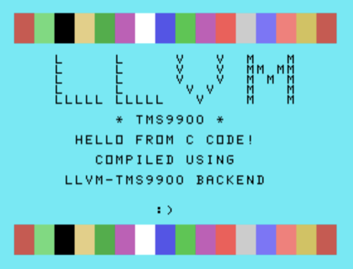

# LLVM Backend for TMS9900 CPU

<p align="center">
  
</p>

An LLVM backend for the [Texas Instruments TMS9900](https://en.wikipedia.org/wiki/TMS9900) — a unique and long-forgotten 16-bit processor that was surprisingly modern in its architecture, but famously hamstrung in the ill-fated [TI-99/4A](https://en.wikipedia.org/wiki/TI-99/4A) home computer. Compiles C, C++ (with STL), and Rust 🦀 to native TMS9900 machine code.

## Highlights

- **Full LLVM 20 toolchain** — clang, opt, lld, llvm-objcopy, assembler, and disassembler. No external tools required.
- **Heavily stress-tested** — 100 Csmith random programs, CoreMark, MiniLZO, sprintf test suite, and 20 hand-written benchmarks (60/60 pass across -O0, -O1, -O2, and -Os).
- **C++ with STL** — freestanding libc++ headers: `vector`, `string`, `tuple`, `optional`, `unique_ptr`, `bitset`, algorithms, and more. Lambdas, multiple inheritance, move semantics, variadic templates all working.
- **Rust `#![no_std]`** 🦀 — builds with `cargo +tms9900 build -Z build-std=core`. See [Rust Support](#rust-support) below.
- **FreeRTOS port** — preemptive multitasking with near-zero-cost context switches via the TMS9900's workspace pointer. See [FreeRTOS](#freertos).
- **Hand-tuned runtime library** — assembly-optimized 32-bit multiply/divide/shift, 64-bit arithmetic, `memcpy`/`memset`/`memmove` exploiting auto-increment addressing, and IEEE 754 soft-float.
- **picolibc math** — single-precision `libm` (sin, cos, sqrt, exp, log, pow, ...) built from [picolibc](https://github.com/picolibc/picolibc) sources, including full-range sinf/cosf argument reduction.
- **GDB/LLDB debugging** — the [tms9900-trace](https://github.com/apullin/tms9900-trace) emulator includes a GDB Remote Serial Protocol stub for interactive debugging with breakpoints, single-stepping, and memory inspection.

## The CPU

The [TMS9900](https://en.wikipedia.org/wiki/TMS9900) (1976) was TI's flagship 16-bit microprocessor. Its most distinctive feature is the *workspace pointer* architecture: instead of fixed hardware registers, the CPU's 16 "registers" are just 32 bytes of RAM pointed to by the Workspace Pointer (WP). `BLWP` loads a new WP and PC, saving the old WP, PC and ST in the new workspace's R13–R15. The old workspace's register values remain in RAM.

The chip also has hardware multiply (16×16→32) and divide (32÷16→16), auto-increment addressing, and a bit-addressable I/O bus (CRU). It was genuinely ahead of its time.

For full details, see the [TMS 9900 Microprocessor Data Manual](https://archive.org/details/tms-9900-microprocessor-data-manual-may-76) (1976).

## Quick Start

### Build the toolchain

```bash
git clone git@github.com:apullin/llvm-tms9900.git
cd llvm-tms9900
git submodule update --init --recursive

cd llvm-project
mkdir build && cd build
cmake -G Ninja \
  -DLLVM_TARGETS_TO_BUILD="" \
  -DLLVM_EXPERIMENTAL_TARGETS_TO_BUILD="TMS9900" \
  -DLLVM_ENABLE_PROJECTS="clang;lld" \
  -DCMAKE_BUILD_TYPE=Release \
  -DLLVM_ENABLE_ASSERTIONS=OFF \
  -DLLVM_INCLUDE_BENCHMARKS=OFF \
  -DLLVM_INCLUDE_EXAMPLES=OFF \
  ../llvm
ninja -j4 clang lld llc opt llvm-mc llvm-objdump llvm-objcopy llvm-readobj llvm-nm llvm-ar llvm-size
export PATH="$PWD/bin:$PATH"
```

TMS9900 is an experimental CMake target. Building the listed tools avoids an
extra assertion build and unnecessary utilities when disk space is limited.

### Compile and link

```bash
# Compile C to object file
clang --target=tms9900 -O2 -ffreestanding -c main.c -o main.o

# Assemble startup code
clang --target=tms9900 -c startup.S -o startup.o

# Link with LLD
ld.lld -T linker.ld startup.o main.o -o program.elf

# Extract raw binary
llvm-objcopy -O binary program.elf program.bin
```

### Run on emulator

```bash
tms9900-trace -l 0x0000 program.bin -n 100000 -S
```

## Repository Structure

```
llvm-tms9900/
├── llvm-project/                # LLVM 20 fork (submodule pins the project revision)
├── libtms9900/
│   ├── builtins/                # Runtime intrinsics (32/64-bit ops, memcpy, soft-float)
│   ├── libm/                    # Math library (picolibc-based, float32)
│   └── picolibc/                # Embedded C library source
├── FreeRTOS/                    # FreeRTOS port with TMS9900 workspace-based context switch
├── tests/
│   ├── benchmarks/              # 20 benchmarks (14 C + 6 C++), 60/60 pass
│   └── stress/                  # Csmith, CoreMark, MiniLZO, sprintf
├── cart_example/                # TI-99/4A cartridge demos (Game of Life, etc.)
├── llvm2xas99.py                # LLVM asm → xas99 format converter (legacy)
└── PROJECT_JOURNAL.md           # Detailed development log
```

## Toolchain

The backend produces ELF object files directly — no external assembler needed:

```
 .c / .S  ──▶  clang -c  ──▶  .o (ELF)  ──▶  ld.lld  ──▶  llvm-objcopy  ──▶  .bin
```

All standard LLVM tools work: `opt` for IR optimization, `llc` for code generation, `llvm-objdump` for disassembly, `llvm-size` for section sizes.

### LTO with translation-unit linker-script rules

Ordinary full LTO is available with `-flto=full`. When the linker script selects
sections by input object or archive name, compile the C/C++ units with the
additional `-flto-linker-scripts` flag and enable the matching mode in LLD:

```bash
clang --target=tms9900 -Oz -ffreestanding -fno-builtin \
  -flto=full -flto-linker-scripts -c main.c -o main.o
clang --target=tms9900 -c startup.S -o startup.o
ld.lld --lto-linker-scripts --lto-Oz -T linker.ld \
  startup.o main.o -o program.elf
```

This mode preserves input-file identity for script patterns such as
`main.o(.text*)`, archive-member selection, `KEEP`, `EXCLUDE_FILE`, and ELF
section-flag predicates. Conditional output sections retain their possible
fallbacks until native linking resolves them. Inlining is allowed between
functions with equivalent placement rules; a function assigned to a different
region remains a call, including when it has `always_inline`.

LLD accepts `--lto-O0`, `--lto-O1`, `--lto-O2`, `--lto-O3`, `--lto-Os`, and
`--lto-Oz` to choose the link-time optimization level. TU-aware linker-script
mode supports **full LTO only** and diagnoses ThinLTO inputs. Ordinary ThinLTO
without this mode remains available. Execution and placement regressions are
documented in [tests/runtime](tests/runtime/README.md); the simulator is optional
and is not a dependency of the LLVM backend's in-tree tests.

## Language Support

### C

Freestanding C11 (`-ffreestanding`), integer sizes through 64-bit, binary32
soft-float, `switch` via jump tables, inline assembly, interrupt handlers, and
naked functions. This is an embedded toolchain rather than a complete hosted
C environment; TLS and atomic runtime operations are not supplied.

### C++ with STL

Freestanding C++ with header-only libc++ from the LLVM tree:

```bash
clang --target=tms9900 -O2 -ffreestanding -fno-exceptions -fno-rtti \
  -fno-threadsafe-statics -nostdinc++ \
  -isystem libcxx_config -isystem llvm-project/libcxx/include \
  -c program.cpp -o program.o
```

**Working STL containers and utilities**: `vector`, `string`, `pair`, `tuple`, `optional`, `string_view`, `unique_ptr`, `initializer_list`, `bitset`, `numeric_limits`, `array`, and algorithms (`find`, `count`, `reverse`, `min`, `max`, `sort`).

**Working language features**: lambdas (all capture modes), multiple inheritance with virtual dispatch, move semantics, perfect forwarding, variadic templates, structured bindings, `constexpr`, `enum class`, static local init.

A minimal C++ runtime (`cxxrt.cpp`) provides `operator new`/`delete` and `__cxa_*` stubs. See `tests/benchmarks/` for examples.

### Rust Support

Rust `#![no_std]` cross-compilation is supported via a custom Rust 1.81.0 build. 🦀

**Setup** (one-time):

1. Clone Rust 1.81.0 into a separate directory and apply TMS9900 patches (calling convention, LLVM component registration)
2. Build stage 1: `python3 x.py build --stage 1 library`
3. Register toolchain: `rustup toolchain link tms9900 build/<host>/stage1`

**Build a Rust program**:

```bash
cargo +tms9900 build -Z build-std=core --target tms9900-unknown-none.json
```

See the [rust-tms9900](https://github.com/apullin/rust-tms9900) repository for the patched Rust fork, target spec, and examples.

**Note**: `core::arch::asm!` is not available for custom targets. Use `extern "C"` calls to assembly files instead.

## FreeRTOS

The `FreeRTOS/` directory contains a full FreeRTOS port that exploits the TMS9900's workspace pointer for near-zero-cost context switching.

### Why the TMS9900 is perfect for an RTOS

On most CPUs, a context switch means saving and restoring all registers — typically dozens of push/pop instructions. On the TMS9900, each task owns a permanent 32-byte *workspace* in RAM. Switching tasks means changing a single 16-bit pointer (WP). The entire register file swaps atomically — no copying, no stack gymnastics.

The FreeRTOS port stores each task's workspace at the top of its stack allocation. On context switch, only 4 words are saved (WP, PC, ST, critical nesting counter), then the new task's WP is loaded and execution resumes with all 16 registers already in place.

### Demo programs

**Basic two-task test** (`main.c`): Two equal-priority tasks increment separate memory markers under preemptive time-slicing. Verifies that the scheduler correctly alternates between tasks.

**Queue + event group rendezvous** (`main_queue.c`): A port of an [MSPM0 Rust demo](https://github.com/apullin/freertos-in-rust-mspm0-demo). A manager task generates random work items and pushes them to a queue; three worker tasks consume items and synchronize at a 4-way event-group rendezvous barrier. Exercises queues, event groups, multiple priority levels, and tick-based delays.

```bash
cd FreeRTOS
make run          # basic two-task test
make run-queue    # queue + rendezvous test
```

## Debugging and Emulation

Development and testing uses [tms9900-trace](https://github.com/apullin/tms9900-trace), a standalone TMS9900 CPU emulator. Instruction traces, memory dumps, and JSON output help diagnose backend bugs. Its cycle counts are estimates; TI-99/4A memory and peripheral wait states require separate hardware timing validation.

### GDB/LLDB remote debugging

The emulator includes a full GDB Remote Serial Protocol (RSP) stub. Connect with GDB or LLDB for interactive debugging:

```bash
# Start emulator in GDB server mode
tms9900-trace -l 0x0000 program.bin --gdb

# In another terminal
lldb
(lldb) gdb-remote localhost:1234
(lldb) register read
(lldb) breakpoint set -a 0x0100
(lldb) continue
```

Supports breakpoints, single-stepping, register and memory inspection, and async break (Ctrl-C).

### Tracepoints

Lightweight PC-hit profiling without full instruction trace overhead:

```bash
tms9900-trace -l 0x0000 program.bin --tracepoint 0x0100 --tracepoint 0x0200 -n 500000 -S
```

Reports hit counts, first/last cycle timestamps — useful for measuring function call frequency and loop iteration counts.

### DWARF debug info

DWARF emission is not yet implemented. ELF binaries contain symbol tables (function names, globals) which are sufficient for the GDB stub's breakpoint and symbol lookup features. Full source-level debugging with line numbers and variable inspection is a future goal.

## Runtime Libraries (`libtms9900/`)

### Compiler Builtins (`builtins/`)

Hand-coded TMS9900 assembly for performance-critical operations:

| Category | Functions |
|----------|-----------|
| 32-bit integer | `__mulsi3`, `__divsi3`, `__udivsi3`, `__modsi3`, `__umodsi3`, `__divmodsi4`, `__udivmodsi4` |
| 32-bit shifts | `__ashlsi3`, `__lshrsi3`, `__ashrsi3` (hardware `R0`-count accelerated) |
| 64-bit integer | `__muldi3`, `__divdi3`, `__udivdi3`, `__moddi3`, `__umoddi3`, `__udivmoddi4`, `__ashldi3`, `__lshrdi3`, `__ashrdi3` |
| Memory & string | `memcpy`, `memset`, `memmove`, `strlen`, `strcmp`, `memcmp` (`*R+` / `CB` auto-increment optimized) |
| Soft-float | `__addsf3`, `__subsf3`, `__mulsf3`, `__divsf3`, comparisons, conversions |

The 32-bit division uses 1- or 2-`DIV` hardware fast paths for all 16-bit divisors and a 16-step Carry loop for 32-bit divisors. Memory and string routines exploit the TMS9900's `*R+` auto-increment addressing mode.

### Math Library (`libm/`)

Single-precision math built from picolibc sources:

`sinf`, `cosf`, `tanf`, `asinf`, `acosf`, `atanf`, `atan2f`, `sinhf`, `coshf`, `tanhf`, `expf`, `logf`, `log10f`, `log2f`, `powf`, `sqrtf`, `fabsf`, `fmodf`, `ceilf`, `floorf`, `roundf`, `scalbnf`, `copysignf`, `ldexpf`, `frexpf`

`sinf`/`cosf` use full-range picolibc reduction and compensated kernels. The
earlier compact override and its size/accuracy claims were removed during the
correctness audit. Functions are linked on demand from the archive.

## Calling Convention

| Register | Usage |
|----------|-------|
| R0–R3    | First four argument words; scalar return words, most-significant first |
| R4–R9    | Caller-saved scratch |
| R10      | Stack Pointer |
| R11      | Link Register (return address) |
| R12      | Caller-saved scratch; reserve explicitly for CRU use |
| R13–R15  | Callee-saved |

Non-variadic calls use R0–R3, then the stack. Multiword values are split into
16-bit words, most-significant first. Variadic calls pass every argument on
the stack. Scalar returns use R0 (16-bit), R0:R1 (32-bit), or R0–R3 (64-bit).
R10 is the downward-growing stack pointer with a four-byte boundary. C scalar
objects of 16 bits and wider have two-byte ABI alignment. BL overwrites R11;
a non-leaf callee saves its incoming link separately before making calls.

## Testing

### Benchmark Suite

20 programs (14 C + 6 C++), all passing across `-O0`, `-O1`, `-O2`, `-O3`, `-Os`, `-Oz`, and full LTO (`160/160`):

| Benchmark | Description | -O0 | -O1 | -O2 | -Oz | -O0 | -O1 | -O2 |
|-----------|-------------|----:|----:|----:|----:|----:|----:|----:|
| | | Code | Code | Code | Code | Cycles | Cycles | Cycles |
| fib | Fibonacci | 166 | 108 | 108 | 112 | 4.7K | 1.7K | 1.7K |
| bubble_sort | Array sort | 408 | 186 | 184 | 196 | 78.1K | 21.7K | 19.1K |
| deep_recursion | Stack + tail recursion | 374 | 196 | 206 | 192 | 72.0K | 22.6K | 24.1K |
| crc32 | CRC-32 hash | 458 | 214 | 386 | 188 | 173K | 67.4K | 40.4K |
| q7_8_matmul | Fixed-point matrix multiply | 596 | 506 | 506 | 446 | 9.6K | 4.5K | 4.5K |
| json_parse | JSON tokenizer | 2.2K | 1.0K | 944 | 878 | 74.2K | 18.6K | 16.1K |
| string_torture | String & memory ops | 1.4K | 1.3K | 1.3K | 1.2K | 22.4K | 16.8K | 16.8K |
| float_torture | IEEE 754 soft-float | 8.6K | 8.0K | 8.0K | 8.0K | 83.5K | 62.1K | 62.1K |
| bitops_torture | popcount, bswap, clz, ctz | 4.6K | 3.2K | 3.2K | 2.1K | 65.9K | 21.0K | 21.0K |
| vertex3d | 3D vertex transforms | 744 | 362 | 362 | 370 | 68.6K | 34.9K | 34.9K |
| huffman | Huffman codec | 2.9K | 1.3K | 1.2K | 1.1K | 1.18M | 406K | 381K |
| long_torture | 30 tests of 32-bit ops | 3.1K | 1.7K | 1.7K | 1.7K | 35.1K | 15.9K | 15.9K |
| heap4 | FreeRTOS-style allocator | 3.9K | 1.7K | 1.8K | 1.8K | 262K | 97.4K | 96.4K |
| i64_torture | 64-bit arithmetic | 8.4K | 6.6K | 6.6K | 6.3K | 218K | 196K | 196K |
| cpp_test | Ctors, vtables, templates | 2.0K | 532 | 532 | 544 | 12.6K | 2.6K | 2.6K |
| lambda_test | Lambda expressions | 14.9K | 3.2K | 2.9K | 2.4K | 48.8K | 4.4K | 3.2K |
| mi_test | Multiple inheritance | 7.5K | 2.5K | 2.1K | 2.2K | 49.6K | 10.0K | 9.2K |
| cpp_adv_test | Move, forwarding, variadic | 4.6K | 1.4K | 1.2K | 1.9K | 73.3K | 14.9K | 15.0K |
| stl_test | vector, string | 40.3K | 20.2K | 19.3K | 16.9K | 268K | 24.7K | 22.4K |
| stl_util_test | tuple, optional, unique_ptr | 10.7K | 1.9K | 1.3K | 2.2K | 135K | 11.1K | 5.8K |

Code sizes (`.text`) in bytes. Zero-wait CPU cycle counts from `tms9900-trace` (`C + 0·M` Data Manual Table 3 + Table A/B model). Full LTO shrinks `stl_test` further to `8.0K` bytes at `-Oz`.

### Stress Tests

| Test | Result | Notes |
|------|--------|-------|
| **Csmith** (100 programs) | 100% self-consistent | `O0 = O1 = O2 = Oz` across all completing programs |
| **CoreMark** | O0–Oz | `11.5K` B / `910K` insns / `14.5M` cycles at `-O2` (`7.2K` B at `-Oz`) |
| **MiniLZO** | O0–Oz | `5.9K` B / `14.4M` cycles at `-O2`, lossless round-trip |
| **sprintf** (35 tests) | 35/35 at O0–Oz | `4.8K` B / `282K` cycles at `-O2` |
| **compiler-rt** (42 suites) | 42/42 at O0–O2 | Unit tests for integer and IEEE-754 builtins |

### LLVM Lit Tests

167 in-tree tests across LLVM CodeGen, MC, Clang, and LLD — all passing.

## Assembler

The integrated assembler supports both LLVM and xas99 syntax:

| Feature | LLVM Style | xas99 Style |
|---------|------------|-------------|
| Labels | `LABEL:` | `LABEL` (no colon) |
| Hex | `0x1234` | `>1234` |
| Comments | `#`, `//`, `;` | `;` |

**xas99 directives**: `DATA`, `BYTE`, `TEXT`, `BSS`, `DEF`, `REF`, `EQU`, `END`.

**CRU bit-addressing**: `SBO`, `SBZ`, `TB` with symbolic offsets.

## TI-99/4A Cartridge Examples

The `cart_example/` directory ships all these demos:

| Programs | Description |
|---|---|
| `banner`, `banner2` | Text banner and TI intro-style color bars |
| `ball`, `ball2` | Bouncing balls; ball2 adds fractional velocity and edge counters |
| `life`, `life2` | Bit-parallel Game of Life, with successive compute optimizations |
| `life2x`, `life2_2x` | 2× pixels, keyboard controls and dirty drawing |
| `life3_2x` | 2× Life with a hand-written assembly row update |
| `kb_test`, `irq_test` | Console keyboard and VBlank-counter experiments |

```bash
cd cart_example
make              # Build every demo and every distribution format
make life3_2x.rpk  # One cartridge, packaged for js99er/MAME
make life2x.img    # One EA5 executable, loaded in expansion RAM at >A000
```

Each demo produces an unpadded `.bin` ROM image and an identical `.cart` copy,
plus an `.rpk` containing that ROM and its XML metadata. Use the cartridge
loader in js99er for these outputs. The `.img` is a separate, single-segment
EA5 RAM executable; it uses the EA5 map and is not a cartridge. `.elf` and
disassembly `.list` files are retained for inspection.

Life3 appears as `GAME OF LIFE 0.2` in the TI menu. Its opening screen shows
`V0.2  OCT 2026` and the controls; press **SPACE** to start. **Z/X/C/V/B**
restart from denser to sparser seeds and remember that setting for **R**
(restart). **D** toggles red dirty-tile highlighting, **F** takes a purple
snapshot of clean tiles, and **1–9** add entropy for later reseeding.
**N** adds scattered live cells to the running board (up to 384 picks, about
3%); **M** adds a randomly placed, half-filled disk 25–47 cells across
(50–94 displayed pixels).
These additions preserve existing live cells and wrap around the toroidal board.

Default compilation is `-O3`, except `life3_2x` uses `-O2`: its assembly update
dominates runtime, and `-O2` saves ROM with almost identical speed. Use
`make LIFE3_OPT=-O3 life3_2x.rpk` to compare, or override `CFLAGS` on the make
command line to select an optimization level for every demo. Flag, compiler, converter and header
changes are tracked, so a partial rebuild cannot reuse artifacts from another
configuration; `make -n` remains read-only. Life's keyboard demos rely on the
TI console ROM, and `irq_test` polls its VBlank counter rather than installing
a new interrupt handler. Their visual/keyboard behavior needs a TI emulator or
hardware; the optional CPU simulator tests verify startup, container builds,
Life board updates and the byte stream sent to the VDP.
The Life3 cartridge fits 8 KiB with these defaults. Explicit optimization
overrides such as `-O0` or `-O3` can exceed the ROM limit; use the EA5 `.img`
target for those levels.

Cartridge and EA5 maps reserve 2 KiB of upper expansion RAM for the C stack,
with static storage and the bump allocator's heap below it. Increase the
reservation with `make STACK_SIZE=0x1000` for 4 KiB (or the linker's
`--defsym=__stack_size=0x1000` before `-T` when linking manually). The
linker checks static storage against the reservation; runtime stack exhaustion
still requires sizing the stack for the application.

## Exotic TODOs

- **Workspace-aware compilation** — The TMS9900's workspace pointer architecture means a context switch (`BLWP`) swaps all 16 registers atomically by changing one pointer. A workspace-aware compiler could allocate "hot" variables directly in the workspace for ISR-heavy or coroutine-style code, avoiding save/restore overhead entirely. This is architecturally unique to the TMS9900 family and has no equivalent in modern compiler backends.
- **Migrate beyond LLVM 20** — Evaluate newer upstream releases with the target regression suites before changing the project's LLVM baseline.
- **Full DWARF debug info** — Source-level debugging with line numbers and variable inspection.
- **CRU-aware register allocation** — Reserve R12 only when CRU I/O instructions are used (currently opt-in via `-mattr=+reserve-cru`).

## Resources

- [TMS 9900 Microprocessor Data Manual](https://archive.org/details/tms-9900-microprocessor-data-manual-may-76) (1976) — the definitive reference
- [tms9900-trace](https://github.com/apullin/tms9900-trace) — TMS9900 CPU emulator with GDB stub
- [xdt99](https://github.com/endlos99/xdt99) — Cross-development tools for TI-99/4A
- [PROJECT_JOURNAL.md](PROJECT_JOURNAL.md) — Detailed development log

## License

Apache 2.0 with LLVM Exceptions (follows upstream LLVM licensing).
